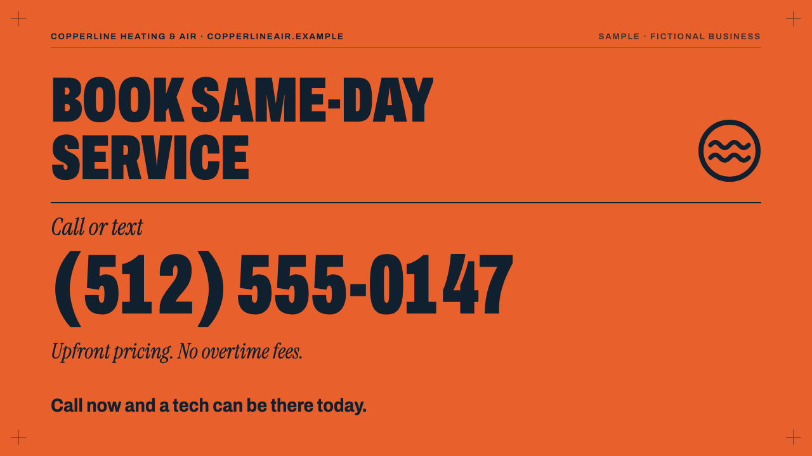

# Promo videos for local businesses

A 15–20 second promo or ad video built from a client's logo, services and phone number, delivered in two formats:

- **Vertical 1080×1920** for Instagram Reels, YouTube Shorts and TikTok ads
- **Wide 1920×1080** for a website hero or YouTube

Every video is rendered from one JSON file, so a new client is a new props file and one command.

**Watch the samples:** https://marven151.github.io/promo-video/

## The offer

| | |
|---|---|
| Client sends | Logo (SVG), brand colors, 3–4 services with one line each, phone number, city, call to action |
| Client gets | Two MP4s (H.264, about 2 MB each) and a 1280×720 poster image |
| Price | $150–$250 |
| Delivery | 3 days, one round of text changes |

No voice-over: captions are paced like speech and highlighted word by word, so the ad works with the sound off. A royalty-free music track can be added (see `music` below); the samples ship silent.

## Samples

Both businesses are fictional. Phone numbers use the reserved 555-01xx range and websites use `.example` domains.

| Business | Vertical | Wide | Poster |
|---|---|---|---|
| Copperline Heating & Air (HVAC, Austin, TX) | [MP4](samples/hvac-copperline-vertical.mp4) | [MP4](samples/hvac-copperline-wide.mp4) | [PNG](samples/hvac-copperline-poster.png) |
| Harbor Light Dental (dentist, Portland, ME) | [MP4](samples/dental-harborlight-vertical.mp4) | [MP4](samples/dental-harborlight-wide.mp4) | [PNG](samples/dental-harborlight-poster.png) |



## Structure of a video

| Scene | Length | What happens |
|---|---|---|
| Hook | 2.4 s | 1–3 short lines in huge condensed type, last line in the accent color |
| Brand | 2.6 s | Logo, business name, tagline, city |
| Services | 2.3 s each | Stacked cards slide in, one per service, with a progress index |
| End card | 4 s | Call to action, phone number rolling in digit by digit, website |

Scenes are joined by two-color panel wipes. Total length: 15.9 s with 3 services, 18.2 s with 4.

Type: Archivo (variable, set at its narrowest width) for display and captions, Instrument Serif Italic for taglines. Both are SIL Open Font License fonts bundled in `public/fonts/`, so rendering needs no network.

## Render a new client video

Requirements: Node 20+ and npm. Remotion downloads its own headless Chrome and ships its own FFmpeg; nothing is installed system-wide.

```bash
npm install
cp props/hvac-copperline.json props/acme-plumbing.json   # edit this file
./render.sh props/acme-plumbing.json                     # or: npm run render -- props/acme-plumbing.json
```

Output lands in `out/`:

- `acme-plumbing-vertical.mp4`
- `acme-plumbing-wide.mp4`
- `acme-plumbing-poster.png` (last frame of the wide cut, 1280×720)

`CRF=23 ./render.sh ...` makes smaller files; the default is 20. To re-render both samples: `npm run render:samples`.

To preview and tweak in Remotion Studio: `npm run dev`, then pick `Vertical` or `Wide` and edit the props in the sidebar.

If a Chrome Headless Shell is already on the machine, `REMOTION_BROWSER_EXECUTABLE=/path/to/chrome-headless-shell` skips Remotion's download.

## Props file

```jsonc
{
  "business": {
    "name": "Copperline Heating & Air",
    "tagline": "Comfort fixed fast, priced up front.",
    "city": "Austin, TX",
    "phone": "(512) 555-0147",
    "website": "copperlineair.example",   // optional
    "established": "Est. 2011"             // optional
  },
  "hook": ["AC quit?", "Not for long."],  // 1–3 short lines
  "services": [                           // 3 or 4
    { "title": "AC repair", "tag": "Same day", "line": "Most repairs are done the same day you call." }
  ],
  "cta": { "headline": "Book same-day service", "sub": "Upfront pricing. No overtime fees." },
  "captions": {                           // service captions come from services[].line
    "hook": "When Austin heat hits, a broken AC can't wait.",
    "brand": "Copperline has kept Austin homes cool since 2011.",
    "end": "Call now and a tech can be there today."
  },
  "colors": { "ink": "#10202E", "paper": "#F2EDE4", "accent": "#E8612C", "onAccent": "#10202E" },
  "logoSvg": "<svg ...>...</svg>",        // optional; use fill/stroke="currentColor" so it recolors per scene
  "music": "music/track.mp3",             // optional; file in public/ or an https URL, fades in and out
  "disclaimer": "Sample · fictional business" // optional small line in the top bar
}
```

The schema lives in `src/schema.ts` (Zod), so Remotion validates every props file before rendering. Text is measured and sized to fit, but keep hook lines and service titles short: they are set very large on purpose.

## Code

- `src/Root.tsx` – the `Vertical` and `Wide` compositions; duration follows the number of services
- `src/Promo.tsx` – scene timeline (`TransitionSeries`), wipes, optional music
- `src/scenes/` – `Hook`, `Brand`, `Services`, `EndCard`; each adapts its layout to the aspect ratio
- `src/Captions.tsx` – speech-paced captions built on `@remotion/captions`
- `src/kit.tsx` – easing, mask reveals, text fitting, top bar, corner marks
- `index.html` – the GitHub Pages sample page

Built with [Remotion](https://www.remotion.dev). Remotion is free for individuals and companies of up to 3 people; larger companies need a [company license](https://www.remotion.pro/license).
